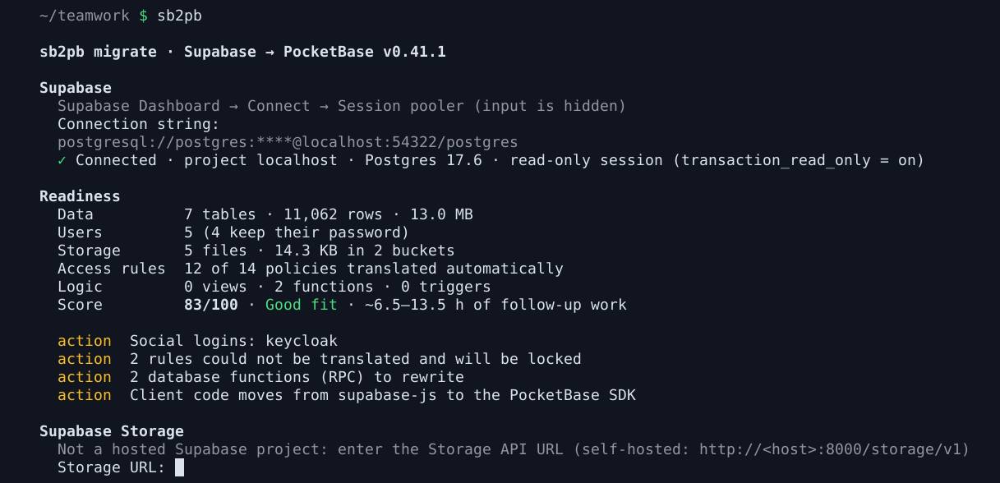
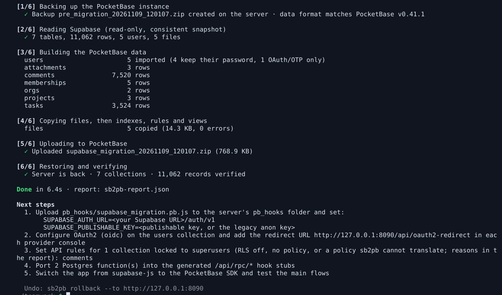
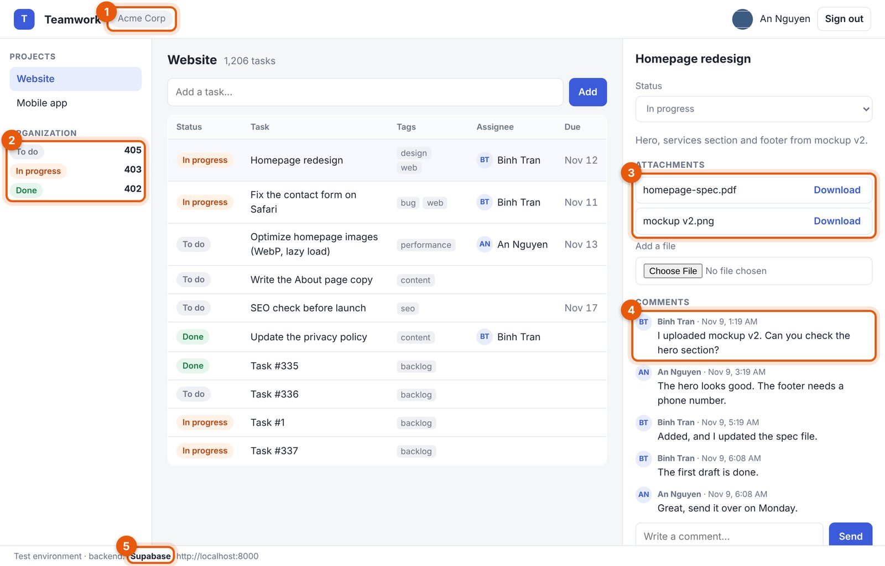
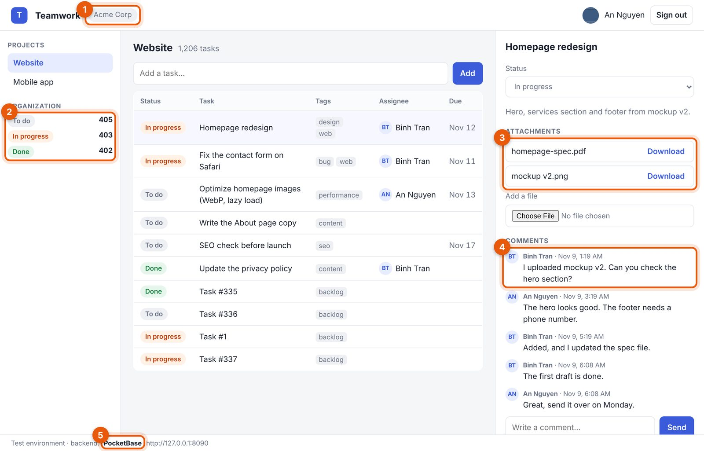
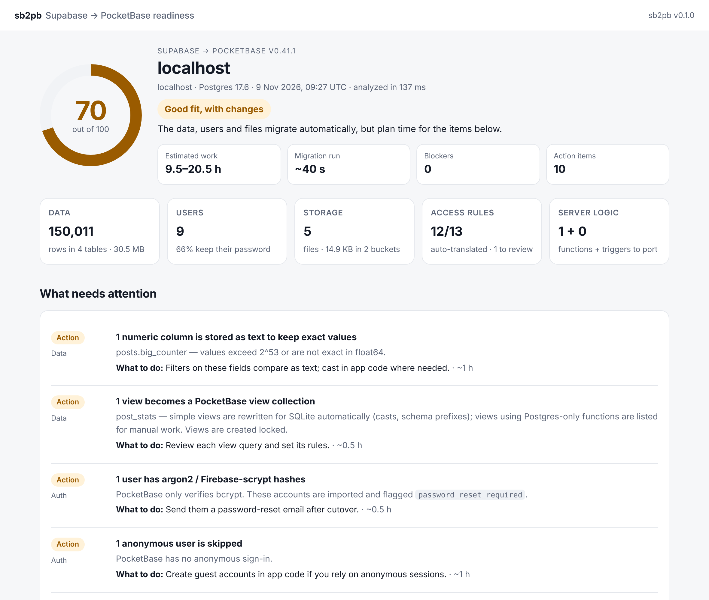

# sb2pb

[](https://github.com/everlasting18/sb2pb/actions/workflows/ci.yml)
[](https://github.com/everlasting18/sb2pb/releases)
[](https://pkg.go.dev/github.com/everlasting18/sb2pb)
[](LICENSE)

Move a Supabase project to PocketBase with one command: schema, users (they keep their passwords),
data, Storage files and Row Level Security policies.

```
$ sb2pb
```

The wizard asks for your Supabase connection string and your PocketBase URL, shows a readiness
report, takes a backup of the PocketBase instance, migrates, and verifies the result.




## Features

- **Guided or scripted.** A wizard with hidden prompts, or environment variables and `--yes` for CI.
- **Read-only on Supabase.** Catalog queries and one `REPEATABLE READ READ ONLY` snapshot; Postgres
  itself refuses writes.
- **Safe on PocketBase.** A backup first, record counts verified after, and `sb2pb rollback` to undo,
  even after dashboard edits.
- **Users.** bcrypt passwords kept, OAuth identities linked, profiles merged into `users`, signed-in
  sessions exchanged without a new login.
- **Data.** Tables, keys, relations and indexes; 265 type and value combinations checked.
- **Access rules.** RLS becomes API rules, including members tables and `WITH CHECK`; anything that
  cannot be translated is locked and listed, never opened.
- **Files.** Storage buckets become file fields, private buckets protected files, byte for byte.
- **App logic.** `DEFAULT` values and `auth.uid()`, `updated_at` triggers, views, and route stubs for
  Postgres functions.
- **Readiness report.** A score, an effort estimate and every behaviour change, before anything moves.
- **Everywhere.** macOS, Linux and Windows binaries, Docker, Homebrew and Scoop; signed releases.

## Use cases

| Your project | What to do | Guide |
|---|---|---|
| Not sure it fits | `sb2pb analyze --html report.html` | [Check first](docs/use-cases.md#check-a-project-before-deciding) |
| A whole app, start to finish | 14 steps, from maintenance mode to switching the SDK | [Step by step](docs/use-cases.md#the-whole-move-step-by-step) |
| Users must not sign in again | deploy the generated hooks, swap the session in the app | [Sessions](docs/use-cases.md#users-keep-their-passwords-and-stay-signed-in) |
| Teams or organizations (RLS through a members table) | translated automatically; write rules for locked collections | [Teams](docs/use-cases.md#teams-and-organizations) |
| Google, GitHub or Keycloak sign-in | add the OAuth2 provider and redirect URL | [Sign-in](docs/use-cases.md#google-github-or-keycloak-sign-in) |
| Files in Storage | give the secret key; review the file access warning | [Files](docs/use-cases.md#files-in-storage) |
| Postgres functions (RPC) | port each generated stub to JavaScript | [RPC](docs/use-cases.md#database-functions-rpc) |
| CI or Docker | environment variables, `--yes`, `--user` for Docker | [CI](docs/use-cases.md#scripts-ci-and-docker) |
| Something went wrong | `sb2pb rollback` | [Undo](docs/use-cases.md#undo) |

The same app before and after the move ([how](docs/use-cases.md#the-whole-move-step-by-step)):

| On Supabase | On PocketBase |
|---|---|
|  |  |

## Install

```sh
brew install everlasting18/tap/sb2pb                    # macOS, Linux
scoop bucket add everlasting18 https://github.com/everlasting18/scoop-bucket
scoop install sb2pb                                       # Windows
go install github.com/everlasting18/sb2pb/cmd/sb2pb@latest
docker run --rm -it --user "$(id -u):$(id -g)" -v "$PWD:/work" ghcr.io/everlasting18/sb2pb
```

Or download a binary from the [releases](https://github.com/everlasting18/sb2pb/releases) page
(macOS, Linux, Windows; amd64 and arm64). Releases are signed with Sigstore (see the release notes).

## What you need

| | Where to find it |
|---|---|
| Supabase connection string | Supabase Dashboard → **Connect** → **Session pooler**, port 5432 (the direct `db.<ref>.supabase.co` host is IPv6-only; the Transaction pooler on port 6543 is refused, sb2pb needs one session) |
| Supabase secret key (only if you have Storage files) | Dashboard → Project Settings → **API Keys** → secret key `sb_secret_...` (the legacy `service_role` key also works) |
| A **fresh** PocketBase instance | PocketBase **v0.41.1** recommended (see [Compatibility](#compatibility)), self-hosted or on [Pocketbasecloud](https://pocketbasecloud.com) |
| Its superuser email and password | the account you created when setting up the instance |

Configure SMTP and OAuth2 providers on the PocketBase instance before migrating if you like:
those settings are kept.

## Usage

### Interactive

```sh
sb2pb            # or: sb2pb migrate
```

Secrets (connection string, keys, passwords) are typed into hidden prompts and never written to
disk, logs or the report.

### Check first, change nothing

```sh
sb2pb analyze --html report.html
```

A read-only readiness report: what migrates automatically, what needs changes, blockers, and an
effort estimate. The session runs with `default_transaction_read_only = on`, so Postgres itself
refuses any write.



### Scripts and CI

Every prompt has an environment variable; `--yes` skips the confirmation.

```sh
export SUPABASE_DB_URL='postgresql://postgres.<ref>:<password>@aws-0-<region>.pooler.supabase.com:5432/postgres'
export SUPABASE_SECRET_KEY='sb_secret_...'
export PB_URL='https://myapp.pocketbasecloud.com'
export PB_SUPERUSER_EMAIL='admin@example.com'
export PB_SUPERUSER_PASSWORD='...'
sb2pb migrate --yes
```

Exit codes: `0` done, `1` failed (the PocketBase data was not replaced unless the message says so),
`2` wrong usage, `3` migrated but some Storage files could not be copied (they are listed), `130`
cancelled.

With Docker, pass `--user "$(id -u):$(id -g)"` so the image can write the report and hooks into the
mounted folder; sb2pb checks this before it touches anything.

### Undo

```sh
sb2pb rollback --to https://myapp.pocketbasecloud.com
```

Restores the `pre_migration_<timestamp>.zip` backup that `migrate` created on the server.

If you changed collections in the dashboard after migrating, PocketBase (with its default `--automigrate`)
wrote files to `pb_migrations` that the old backup does not know. `rollback` marks those files as applied in
the restored data so the server starts again, and lists them.

## Commands

| Command | Does |
|---|---|
| `sb2pb` / `sb2pb migrate` | Analyze → back up the target → migrate → restore → verify record counts |
| `sb2pb analyze` | Read-only readiness report (`--html`, `--json`) |
| `sb2pb rollback` | Restore the newest pre-migration backup (`--backup <name>`, `--list`) |
| `sb2pb version` | Tool and embedded PocketBase versions |

`migrate` options:

| Option | Default | |
|---|---|---|
| `--from` | `$SUPABASE_DB_URL` or prompt | Supabase connection string |
| `--to` | `$PB_URL` or prompt | PocketBase URL |
| `--email` | `$PB_SUPERUSER_EMAIL` or prompt | superuser email (password: `$PB_SUPERUSER_PASSWORD` or prompt) |
| `--storage` | derived from the project ref | Storage API URL; only needed for self-hosted Supabase (`http://<host>:8000/storage/v1`) |
| `--skip-files` | off | do not copy Storage files |
| `--hooks-out` | `pb_hooks` | where the generated hooks are written |
| `--report` | `sb2pb-report.json` | migration report |
| `--yes` | off | no confirmation prompt |
| `--allow-blockers` | off | migrate even when the readiness check finds blockers |
| `--keep-work` | off | keep the temporary working copy (contains all migrated data) |

## What gets migrated

| Supabase | PocketBase |
|---|---|
| Tables, primary/foreign keys, unique constraints, indexes | Collections, relation fields, unique indexes |
| Tables without a primary key, composite keys, partitioned tables | Collections with derived record ids (identical rows are all kept); a partitioned table is one collection |
| UUID primary keys | Kept as record ids, so links and URLs keep working |
| `auth.users` + a `profiles` table keyed by user id | The `users` auth collection (profile columns merged in; a column named like a sign-in field, such as `email` or `phone`, becomes `profile_email`, `profile_phone`) |
| Other tables keyed by user id (`user_settings`, `customers`…) | Collections of their own, with the user id as record id |
| bcrypt password hashes | Kept: users sign in with their current password |
| argon2 / Firebase scrypt hashes | Imported, flagged `password_reset_required` |
| OAuth identities (Google, GitHub, Apple, Keycloak…) | `_externalAuths`, so users land on the same account |
| Storage buckets and objects | File fields (public buckets) and protected files (private buckets); a download that fails or stops early is retried, then listed as an error, never stored as a partial file |
| RLS policies (`auth.uid()`, `TO authenticated`, `EXISTS` joins, membership tables such as `org_id IN (select org_id from memberships where user_id = auth.uid())`, `WITH CHECK`) | API rules; anything not translatable is locked to superusers and listed, and so is a table only other roles could reach (a policy `TO service_role`, an internal or custom role, or no privileges for `anon`/`authenticated`) |
| Column `DEFAULT`s | A generated `onRecordCreate` hook |
| `DEFAULT auth.uid()` columns (`created_by`, `author_id`…) | A generated hook fills in the signed-in user, so apps that leave the column out keep working; insert rules accept the empty value |
| "Updated at" triggers (`moddatetime(updated_at)` or a one-line `NEW.updated_at = now()` function) | Autodate fields that PocketBase sets on every update |
| Views | View collections when the SQL runs on SQLite, otherwise listed as manual work |
| Postgres functions (RPC) | Generated `/api/rpc/<name>` stubs to fill in |
| Active sessions | A generated `/api/supabase/exchange` endpoint swaps a valid Supabase token for a PocketBase one |

Data types are mapped field by field (numeric precision, ±infinity dates, NaN, arrays, JSON,
PostGIS points, pgvector, bytea, …); the end-to-end suite checks 265 type/value combinations.
The report lists every conversion that loses information.

## Not migrated (you get a list)

Edge Functions, other triggers and Postgres function bodies, Realtime subscriptions in client code,
pgvector similarity search, full-text search (`tsvector`), PostGIS shapes other than points,
SMS/phone login, anonymous users, TOTP factors, and your client code (supabase-js → PocketBase SDK).

### Not supported yet (found before anything moves)

PocketBase names may only contain letters, digits and `_`. `analyze` lists the following as blockers
and `migrate` stops before the PocketBase instance is touched; rename them on Supabase first:

- table or column names with spaces, dashes or non-ASCII letters, or that differ only in case;
- a `public.users` table that is not keyed by the auth user id (the name belongs to PocketBase's
  own users collection).

### Behaviour that changes

- Files referenced from a table row (for example `attachments.file_path`) are served under that
  collection's view rule. Storage policies of a private bucket, such as "only the uploader can read",
  no longer apply. The readiness check lists each case so you can tighten the rule.
- A column called `id` that is not the primary key, and columns named `expand`, `collectionId` or
  `collectionName`, are kept as `<name>_col`: PocketBase reserves those names.
- PocketBase adds a random suffix to the names of newly uploaded files (`quote_vdm9dbde8a.pdf`);
  migrated files keep their names. Store the original name in a text field if your app shows it.
- Ported RPC hooks run without API rules. A `SECURITY INVOKER` function relied on RLS, so check
  access in the hook (each generated stub says which kind the function was).

## How it works

1. **Analyze** the source over a read-only session (catalog queries and aggregates only).
2. **Back up** the PocketBase instance through its API (`pre_migration_<timestamp>.zip`) and check
   that its data format (system migrations) matches the PocketBase release sb2pb embeds.
3. **Read** Supabase inside one `REPEATABLE READ READ ONLY` transaction, so all tables come from the
   same snapshot.
4. **Build** a new `pb_data` offline on top of that backup with the embedded PocketBase core, which
   keeps your superusers, settings and OAuth configuration.
5. **Upload and restore** it as a PocketBase backup, wait for the server, and compare record counts.

## Safety and privacy

- The Supabase session is read-only; nothing in your Supabase project is changed.
- The PocketBase instance must be empty; it is backed up before anything is replaced.
- The working copy lives in a private temporary directory and is deleted afterwards.
- Keys and passwords are only read from hidden prompts or environment variables, never from flags,
  and are not written to logs or the report. The connection string contains the database password:
  `--from` accepts it for convenience and warns that it then sits in your shell history, so prefer
  the prompt or `SUPABASE_DB_URL`.

## Compatibility

- **PocketBase v0.41.1** is the release sb2pb embeds and builds the data with. Before building, it
  compares the system migrations recorded on the server with its own: an older server with the same
  data format is accepted (tested: v0.40.6), one that lacks system migrations is refused with an
  upgrade hint (tested: v0.38.2), and one with unknown Go migrations (a newer PocketBase, or your own
  Go migrations in a custom build) is refused unless you pass `--skip-version-check`.
- **Supabase**: hosted projects (session pooler or direct connection) and self-hosted stacks,
  tested on Postgres 17. The end-to-end suite runs against a real self-hosted Supabase stack; hosted-only
  details (pooler user `postgres.<ref>`, `sb_secret_` keys) follow the Supabase documentation.
- During the move, put the app in maintenance mode: rows written after the snapshot are not copied.

## Development

```sh
go test ./...        # unit tests
e2e/run.sh           # full end-to-end run (Docker, Go, Python 3)
```

See [CONTRIBUTING.md](CONTRIBUTING.md).

## License

MIT. sb2pb is an independent project and is not affiliated with Supabase or PocketBase.
