# Use cases

What to do for each kind of Supabase project, and what you will see. The screenshots come from the
end-to-end runs against a real self-hosted Supabase project, **Teamwork**: a multi-tenant task app
written with supabase-js. Numbered orange marks in a screenshot are
explained in the list under it.

- [The whole move, step by step](#the-whole-move-step-by-step)
- [Check a project before deciding](#check-a-project-before-deciding)
- [Users keep their passwords and stay signed in](#users-keep-their-passwords-and-stay-signed-in)
- [Teams and organizations (RLS through a members table)](#teams-and-organizations)
- [Google, GitHub or Keycloak sign-in](#google-github-or-keycloak-sign-in)
- [Files in Storage](#files-in-storage)
- [Columns that Postgres fills in](#columns-that-postgres-fills-in)
- [Database functions (RPC)](#database-functions-rpc)
- [Scripts, CI and Docker](#scripts-ci-and-docker)
- [Typing mistakes](#typing-mistakes)
- [Undo](#undo)
- [A server on another PocketBase release](#a-server-on-another-pocketbase-release)

## The whole move, step by step

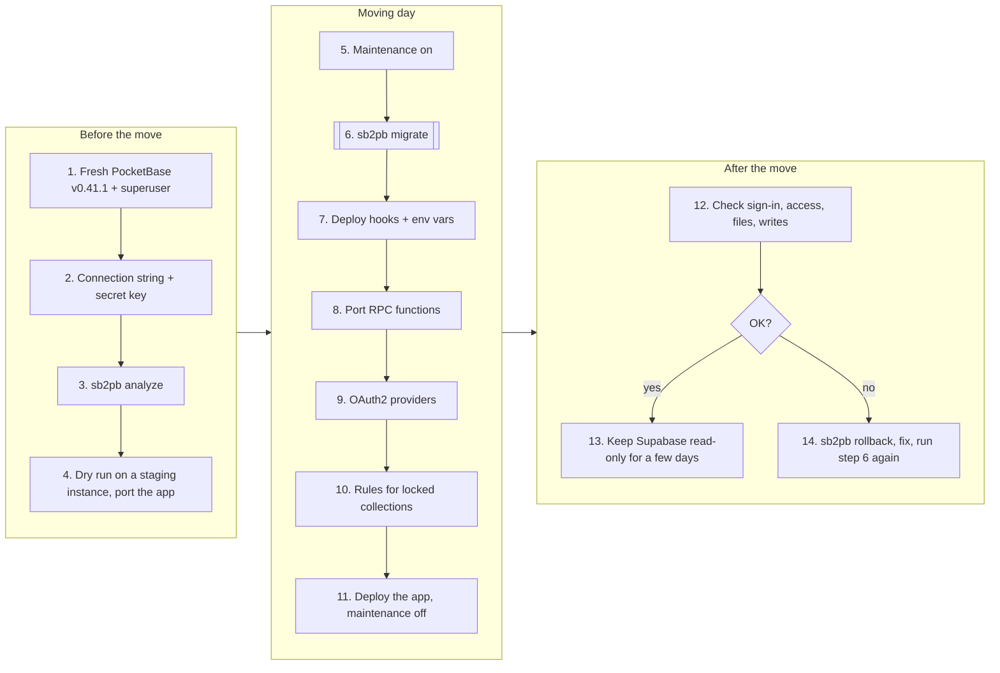

**Before.** The app runs on Supabase. Gather everything the move needs into one data layer file
(`data.js` in Teamwork), so step 11 replaces one file.

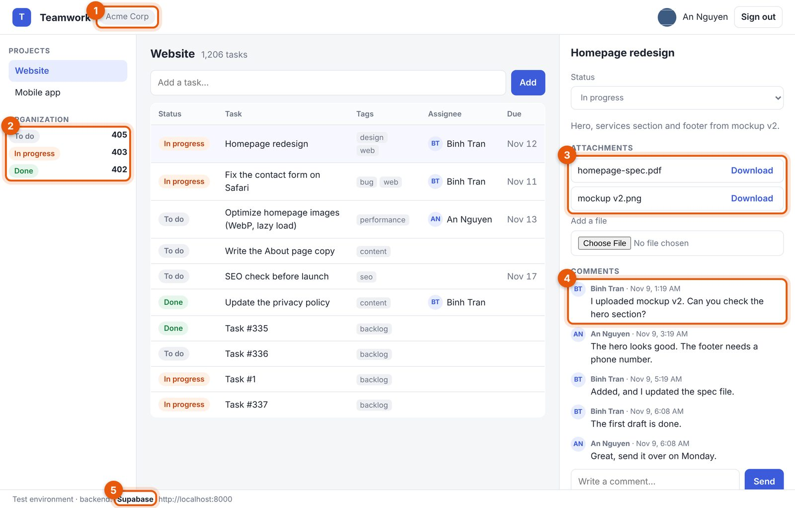

1. Each user only sees their own organization (RLS)
2. Counts from the RPC function `org_task_stats`
3. Files in a private bucket
4. Comments
5. Backend in use: Supabase

**Step 5.** Turn on maintenance so nobody writes while the data is copied: rows written after the
snapshot are not moved.

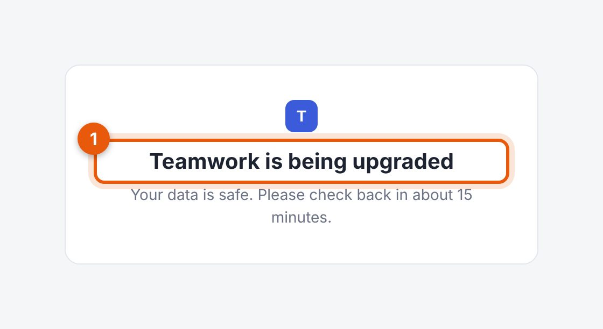

**Steps 3 and 6.** The readiness report comes first; nothing is written until you confirm.

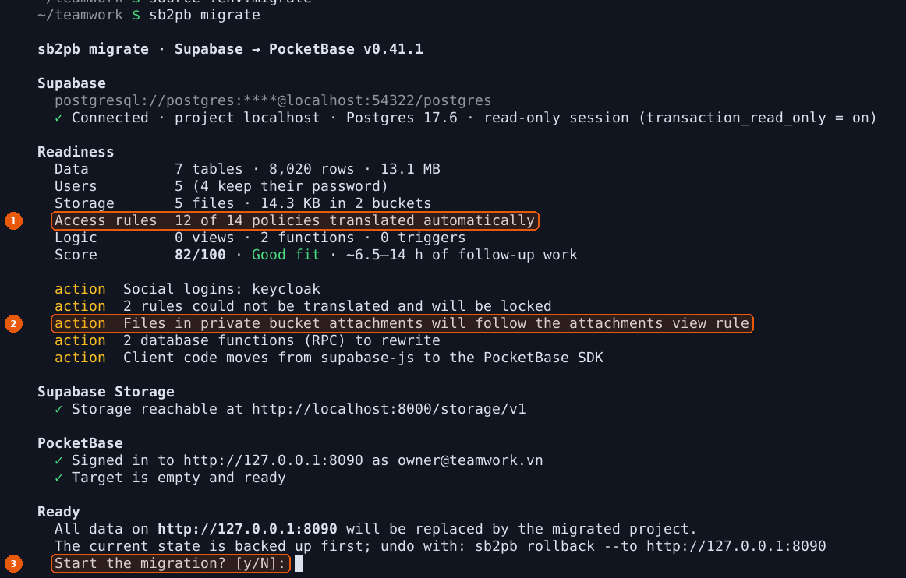

1. 12 of 14 policies become API rules automatically
2. A behaviour change to review (see [Files in Storage](#files-in-storage))
3. Nothing is written before this question

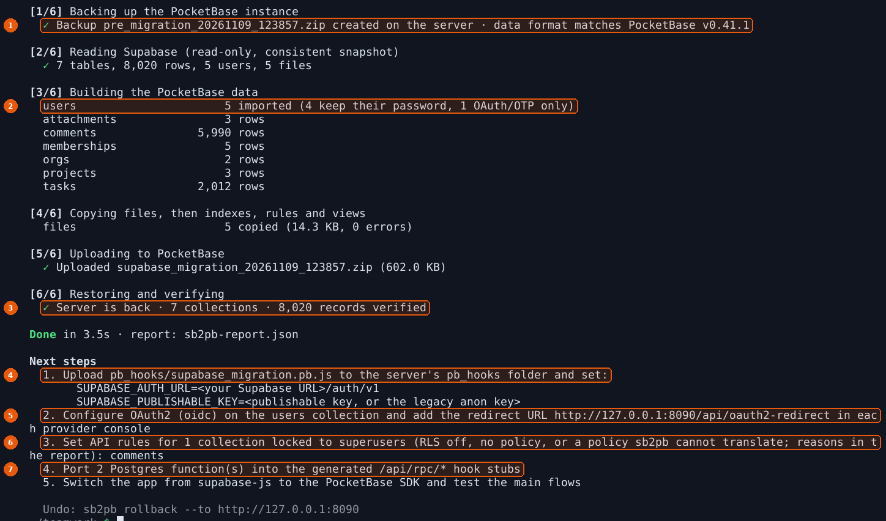

1. Safety backup on the server, data format checked
2. Users: 4 keep their password, 1 signs in with OAuth only
3. The server confirms every record
4. Step 7
5. Step 9
6. Step 10
7. Step 8

**Step 7.** Copy the generated hooks and set two variables; they let users who are signed in on
Supabase keep their session.

```sh
cp pb_hooks/supabase_migration.pb.js <pocketbase>/pb_hooks/
SUPABASE_AUTH_URL=https://<ref>.supabase.co/auth/v1
SUPABASE_PUBLISHABLE_KEY=sb_publishable_...
# then restart PocketBase
```

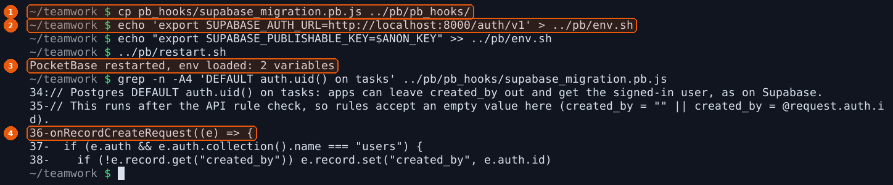

1. Copy the hooks file
2. Variables for the session exchange
3. Restart
4. A generated hook: fills `created_by` when the app leaves it out

**Steps 9 and 10** are done in the PocketBase dashboard; see [sign-in](#google-github-or-keycloak-sign-in)
and [teams](#teams-and-organizations).

**Step 11.** Switch the data layer to the PocketBase SDK, deploy, turn maintenance off.

| supabase-js | PocketBase SDK |
|---|---|
| `auth.signInWithPassword({email, password})` | `pb.collection('users').authWithPassword(email, password)` |
| `auth.signInWithOAuth({provider: 'google'})` | `pb.collection('users').authWithOAuth2({provider: 'google'})` |
| `from('tasks').select().eq('project_id', p).order('updated_at', {ascending: false}).range(0, 9)` | `pb.collection('tasks').getList(1, 10, {filter: pb.filter('project_id = {:p}', {p}), sort: '-updated_at'})` |
| `from('tasks').insert({...})` | `pb.collection('tasks').create({...})` |
| `from('tasks').update({...}).eq('id', id)` | `pb.collection('tasks').update(id, {...})` |
| `rpc('org_task_stats', {p_org})` | `pb.send('/api/rpc/org_task_stats', {method: 'POST', body: {p_org}})` |
| `storage.from(b).createSignedUrl(path, 60)` | `pb.files.getURL(rec, rec.file_path, {token: await pb.files.getToken()})` |
| `storage.upload(...)` then `insert(...)` | `create(formData)` with the file in the form |
| `channel().on('postgres_changes', ...)` | `pb.collection('tasks').subscribe('*', cb)` |

**After.** Same app, same numbers, now on PocketBase.

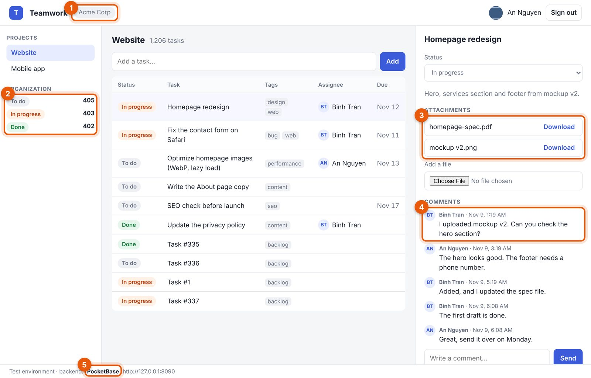

1. Same organization
2. Counts from the ported hook
3. Files, byte-identical to Supabase
4. Comments
5. Backend in use: PocketBase

## Check a project before deciding

```sh
sb2pb analyze --html report.html
```

Read-only: the session runs with `default_transaction_read_only = on`. You get a score, an effort
estimate and the list of things to do by hand.

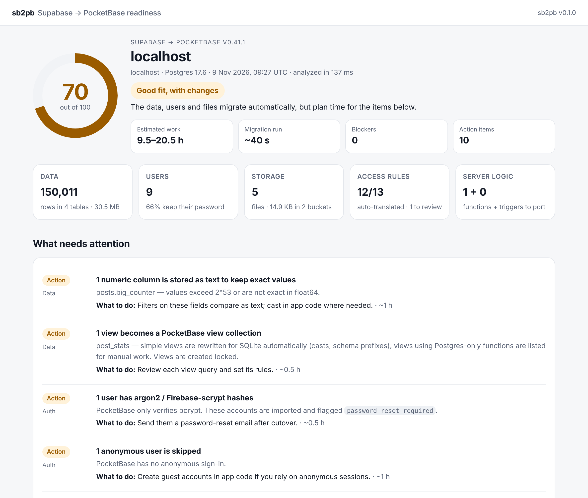

## Users keep their passwords and stay signed in

bcrypt hashes are copied as they are, so users sign in with their current password. OAuth identities
are linked, so "Sign in with Google" lands on the same account. For users who are signed in when you
switch, the app swaps their Supabase token once through the generated `/api/supabase/exchange` route:

```js
// Users who were signed in on the Supabase version stay signed in: swap their Supabase token once.
const oldKey = Object.keys(localStorage).find(k => /^sb-.+-auth-token$/.test(k));
if (oldKey) {
  if (!pb.authStore.isValid) {
    try {
      const { access_token } = JSON.parse(localStorage.getItem(oldKey));
      const res = await pb.send("/api/supabase/exchange", { method: "POST", body: { access_token } });
      pb.authStore.save(res.token, res.record);
    } catch (e) { console.warn("Supabase session not exchanged:", e?.message); }
  }
  localStorage.removeItem(oldKey);
}
```

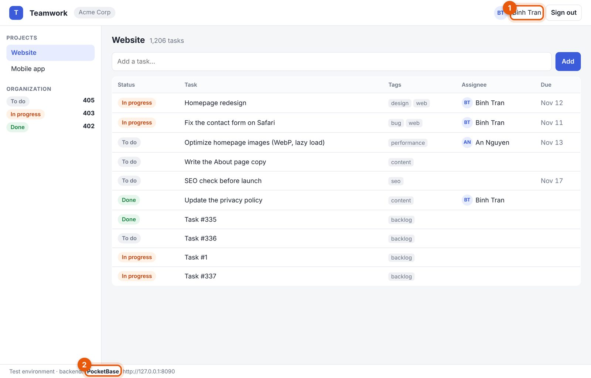

1. Still signed in as the same user
2. Backend: PocketBase

## Teams and organizations

Policies that check a members table become PocketBase joins. Each `EXISTS` gets its own alias, and
`WITH CHECK` on updates becomes a check on the request body.

```sql
create policy "members see tasks" on tasks for select to authenticated
  using (exists (select 1 from memberships m where m.org_id = tasks.org_id and m.user_id = auth.uid()));
```

```
@request.auth.id != "" && (@collection.memberships:rls_m1.org_id ?= org_id
                       && @collection.memberships:rls_m1.user_id ?= @request.auth.id)
```

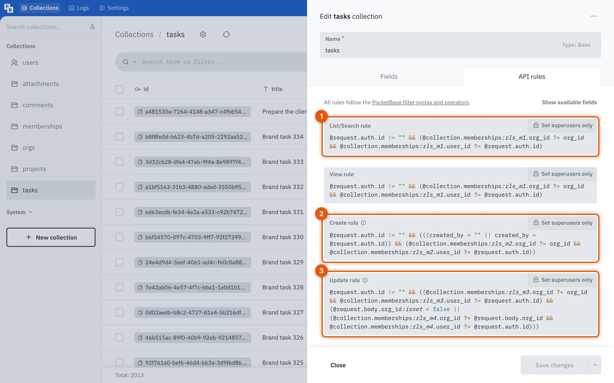

1. List/view: members of the task's organization
2. Create: you are a member and the creator is you (an empty `created_by` is accepted; the generated hook fills it in)
3. Update: cannot move a task to an organization you are not in

Policies that call your own SQL functions cannot be translated; the collection is locked to
superusers and listed with the reason. Write the rule by hand:

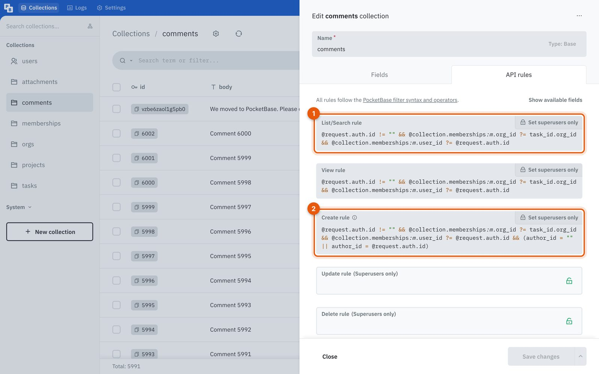

1. Read: members of the task's organization
2. Create: the same, and you are the author

## Google, GitHub or Keycloak sign-in

Add the provider on the `users` collection (Collections → users → ⚙ → Options → OAuth2) and add
`https://<pocketbase>/api/oauth2-redirect` to the provider's allowed redirect URLs.

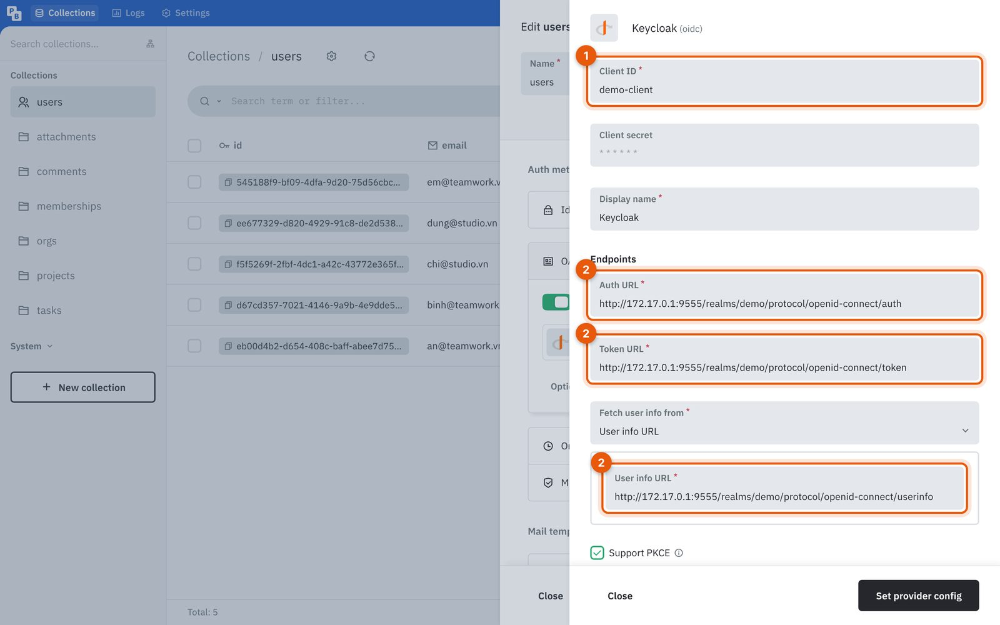

1. Client ID and secret from your provider
2. Realm endpoints (OIDC only; Google and GitHub need none)

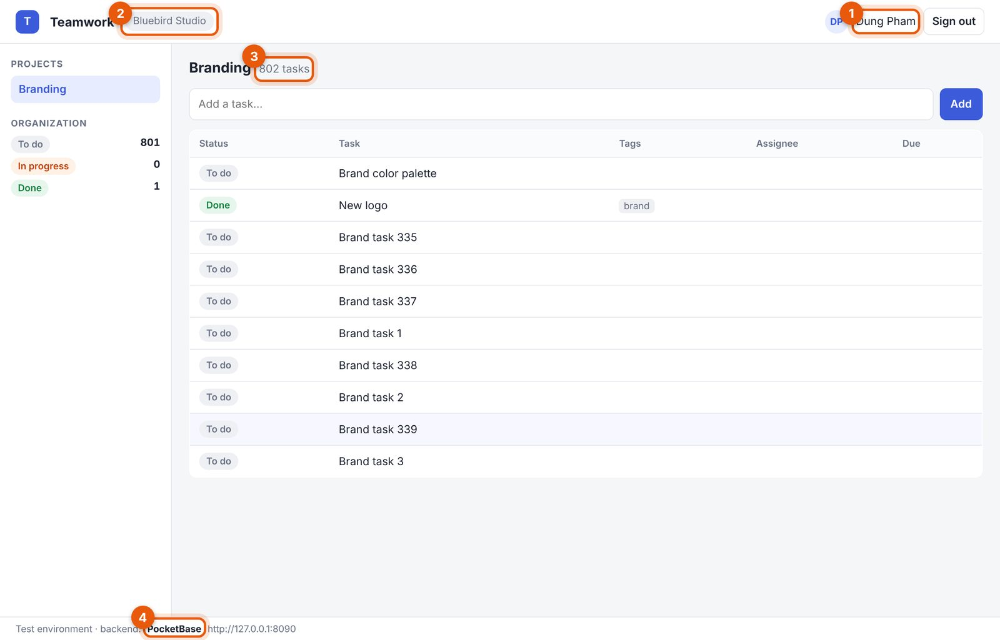

1. Same user
2. Same organization
3. Same tasks
4. Backend: PocketBase

## Files in Storage

Give sb2pb the secret key (`sb_secret_...`). Public buckets stay public, private buckets become
protected files, and every file is copied byte for byte.

One rule changes. A file referenced from a row (for example `attachments.file_path`) is served under
that collection's view rule. A Storage policy such as "only the uploader can read" no longer applies,
so colleagues who can see the row can open the file. The readiness report warns about each case;
tighten the view rule if you need the old behaviour.

| Supabase | PocketBase |
|---|---|
| 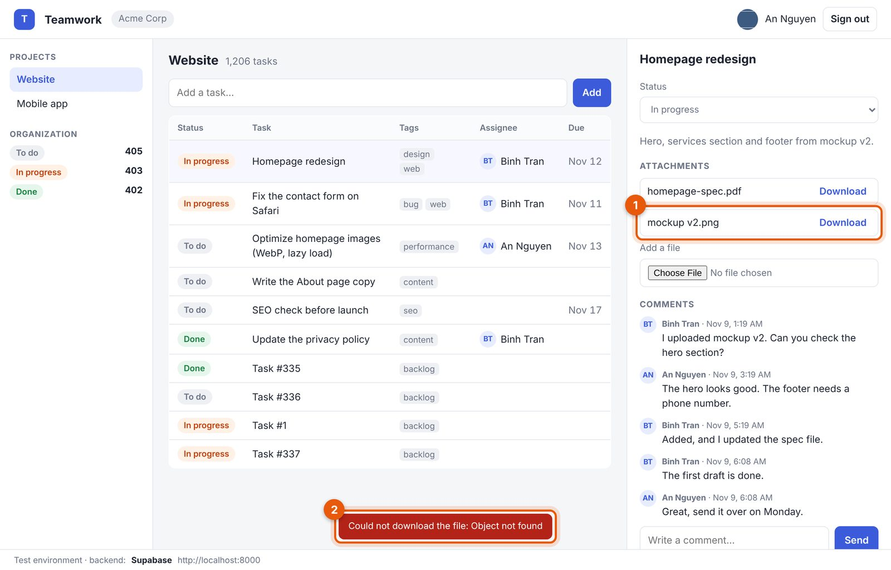 | 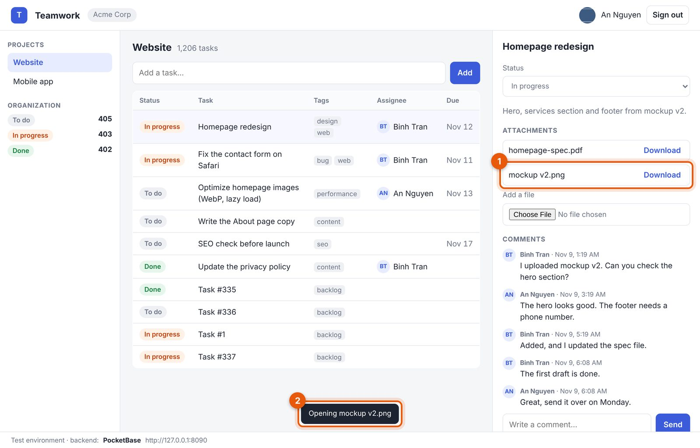 |
| Another user's file: "Object not found" | Opens, because the row is visible |

New uploads get a random suffix in their name (`quote_vdm9dbde8a.pdf` for `quote.pdf`); store the original name in a
text field if your app shows it.

## Columns that Postgres fills in

- `DEFAULT auth.uid()` (`created_by`, `author_id`, …): a generated hook fills in the signed-in user,
  so code that left the column out keeps working.
- `updated_at` kept current by `moddatetime` or a one-line trigger becomes an autodate field.
- Other `DEFAULT` values come from a generated `onRecordCreate` hook.

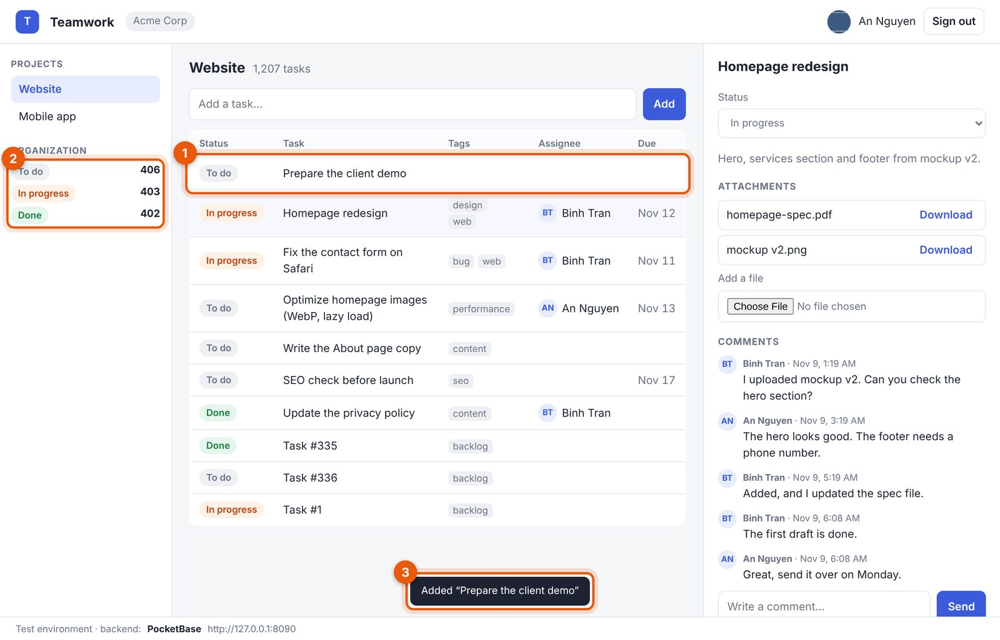

1. The new task, owned by the signed-in user
2. Counts updated
3. Saved

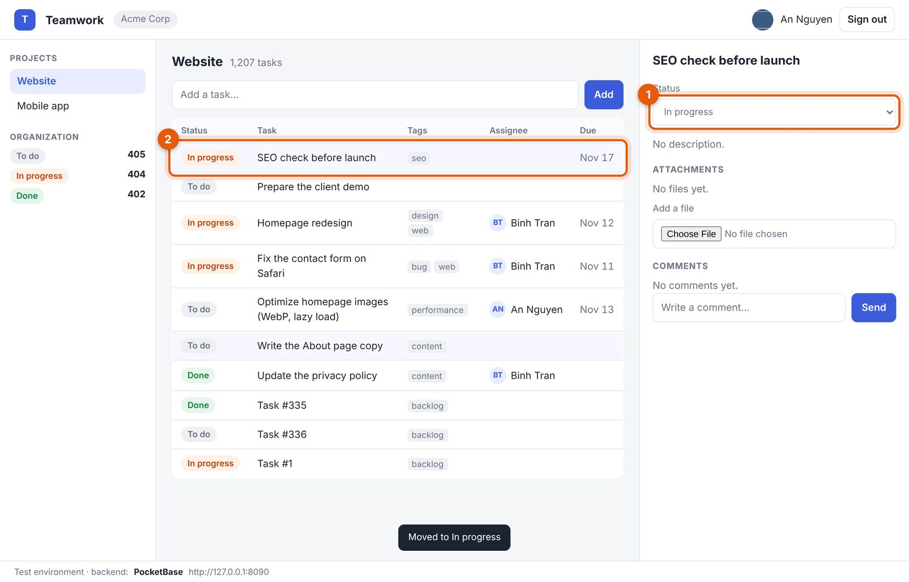

1. Status changed
2. `updated_at` changed, so it sorts first

## Database functions (RPC)

Each Postgres function gets a stub route in the hooks file that says whether the function ran with
the caller's RLS. Port the body to JavaScript. A hook bypasses API rules, so check access yourself:

```js
// Ported from public.org_task_stats(p_org uuid): task count per status for one org.
// The Postgres function ran with the caller's RLS, so only members got numbers; a hook bypasses API rules, so check it here.
routerAdd("POST", "/api/rpc/org_task_stats", (e) => {
  if (!e.auth) throw new UnauthorizedError("sign in first")
  const org = (e.requestInfo().body || {}).p_org || ""
  try {
    e.app.findFirstRecordByFilter("memberships", "org_id = {:org} && user_id = {:uid}", { org: org, uid: e.auth.id })
  } catch (_) {
    return e.json(200, []) // like RLS: no rows for non-members
  }
  const rows = arrayOf(new DynamicModel({ status: "", n: 0 }))
  e.app.db().newQuery("SELECT status, COUNT(*) AS n FROM tasks WHERE org_id = {:org} GROUP BY status").bind({ org: org }).all(rows)
  return e.json(200, rows)
})
```

## Scripts, CI and Docker

```sh
export SUPABASE_DB_URL=... SUPABASE_SECRET_KEY=... PB_URL=https://app.example.com
export PB_SUPERUSER_EMAIL=... PB_SUPERUSER_PASSWORD=...
sb2pb migrate --yes

docker run --rm --user "$(id -u):$(id -g)" -v "$PWD:/work" \
  -e SUPABASE_DB_URL -e SUPABASE_SECRET_KEY -e PB_URL -e PB_SUPERUSER_EMAIL -e PB_SUPERUSER_PASSWORD \
  ghcr.io/pocketbasecloud/sb2pb migrate --yes
```

Without `--user`, the image cannot write into the mounted folder; sb2pb stops before it touches
anything and says how to fix it:

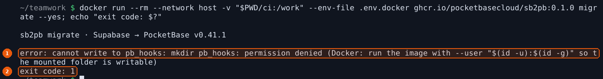

1. The error and the fix
2. Exit code 1, nothing changed

## Typing mistakes

Wrong keys and passwords are explained and asked again; answering N cancels without changes.
Secrets never appear on screen.

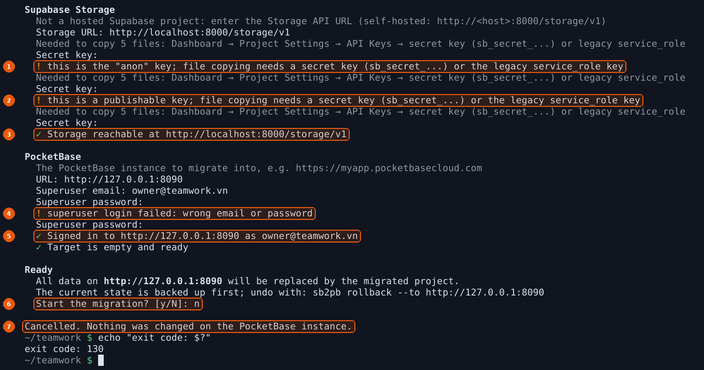

1. The anon key instead of the secret key
2. A publishable key
3. The right key: Storage reachable
4. Wrong superuser password
5. Signed in
6. Last question
7. Cancelled, nothing changed (exit 130)

## Undo

```sh
sb2pb rollback --to https://app.example.com
```

Restores the backup taken before the move. If dashboard changes after the move wrote files to
`pb_migrations`, they are marked as applied so PocketBase starts again.

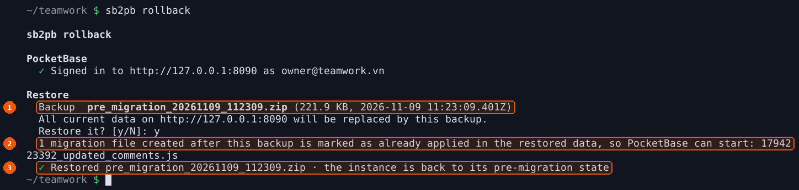

1. The backup taken before the move
2. Migration files created since then, marked as applied
3. Restored

## A server on another PocketBase release

sb2pb builds the data with the PocketBase release it embeds (v0.41.1) and compares system migrations
with the server. An older server with the same data format is accepted (tested: v0.40.6); one that
lacks migrations is refused before anything changes:

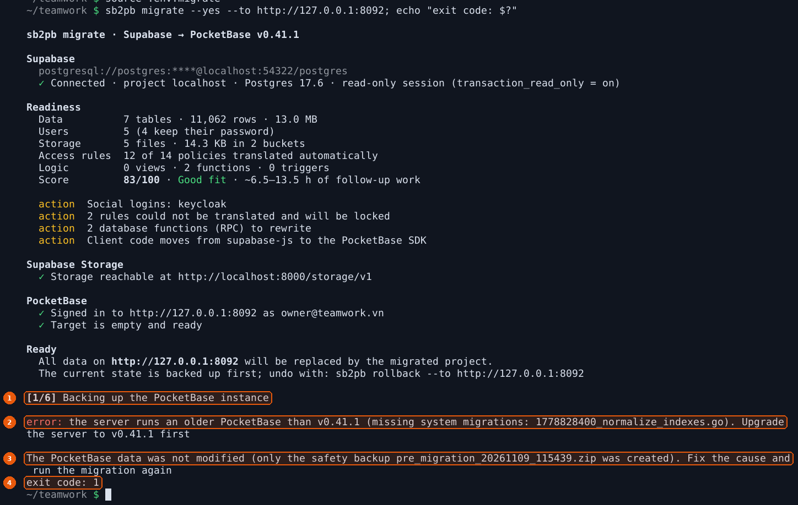

1. Backup step
2. Which migration is missing and what to upgrade to
3. PocketBase data not modified
4. Exit code 1

